<a href="https://velaxis.net">
  <picture>
    <source media="(prefers-color-scheme: dark)" srcset="assets/header-dark.svg"/>
    
  </picture>
</a>

  
  
  
   
  

---

### About me

- 🎓 Master's student in **Mechanical Engineering** at FSB, University of Zagreb
- 🛡️ Running **[Velaxis Engineering](https://velaxis.net)**, a one-person IT & cybersecurity practice: network infrastructure, Active Directory, SIEM monitoring, firewalls, backups and NIS2 readiness for healthcare and public-sector clients
- 🏭 Working on **OT security monitoring** in a university lab, where industrial systems meet IT security
- 🏎️ Former Head of IT & Systems and General Secretary of **FSB Racing Team** (Formula Student)
- 📜 Currently studying for **CompTIA Security+**, then **CCNA**
- 🧪 I run a home lab (Proxmox, TrueNAS, WireGuard, local LLMs) where I test everything before it goes to clients

### Recently worked on

<!--START_SECTION:recent-->
| Repo | What it is | Language | Last push |
|---|---|---|---|
| [**FEA-ACCU-Layup-Opt**](https://github.com/Garmaz23/FEA-ACCU-Layup-Opt) | — | Python | 8 months ago |
| [**Zdenac-API**](https://github.com/Garmaz23/Zdenac-API) | Refactor of real API designed with Node.JS. It's ready to use with autentification and autorization configured using ASP.NET Identity and JWT web token.  🤝 | C# | 2 years ago |
| [**AnimalsAPI**](https://github.com/Garmaz23/AnimalsAPI) | If you need WEB API for you Zoo or animal shelter, this open source API is right tool for you. Enjoy! | C# | 4 years ago |
| [**Airport**](https://github.com/Garmaz23/Airport) | This project contains multiple modules of Split's airport created with Blazor, C# and MySQL | C# | 4 years ago |
| [**MERN-web-template**](https://github.com/Garmaz23/MERN-web-template) | This repo is website template developed by MERN stack. Enjoy! | JavaScript | 4 years ago |
<!--END_SECTION:recent-->

### Recently exploited in the wild

<!--START_SECTION:kev-->
| CVE | Affected | Weakness | Added | Ransomware |
|---|---|---|---|---|
| [`CVE-2026-102764`](https://nvd.nist.gov/vuln/detail/CVE-2026-102764) | BeyondTrust Remote Support | Authentication Bypass by Spoofing | 2026-10-16 | — |
| [`CVE-2025-61624`](https://nvd.nist.gov/vuln/detail/CVE-2025-61624) | Fortinet Multiple Products | Path Traversal | 2026-10-16 | — |
| [`CVE-2026-21589`](https://nvd.nist.gov/vuln/detail/CVE-2026-21589) | Atlassian Multiple Products | Files or Directories Accessible to External Parties | 2026-10-15 | — |

Newest of 1,748 entries in the [CISA KEV catalog](https://www.cisa.gov/known-exploited-vulnerabilities-catalog), catalog updated 2026-10-16. Refreshed daily by a GitHub Action.
<!--END_SECTION:kev-->

### Tools I work with

**Infrastructure & security** 

**Code & data** 

**Engineering** 

### Outside of work

Road trips, hiking, and doing my own repairs on my car.

<!---
Garmaz23/Garmaz23 is a special repository because its README.md appears on your GitHub profile.
--->
